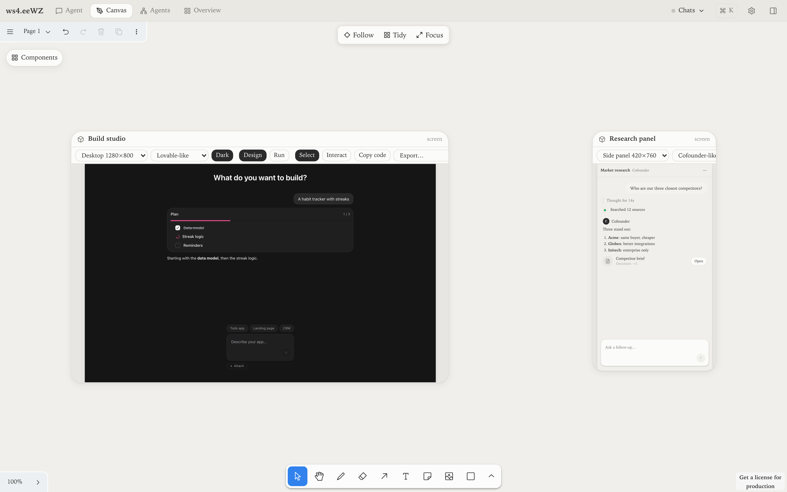
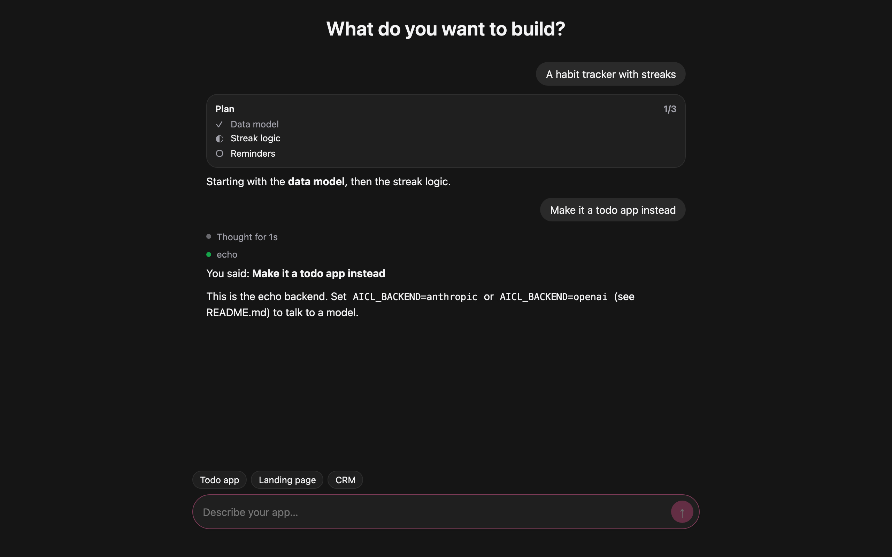
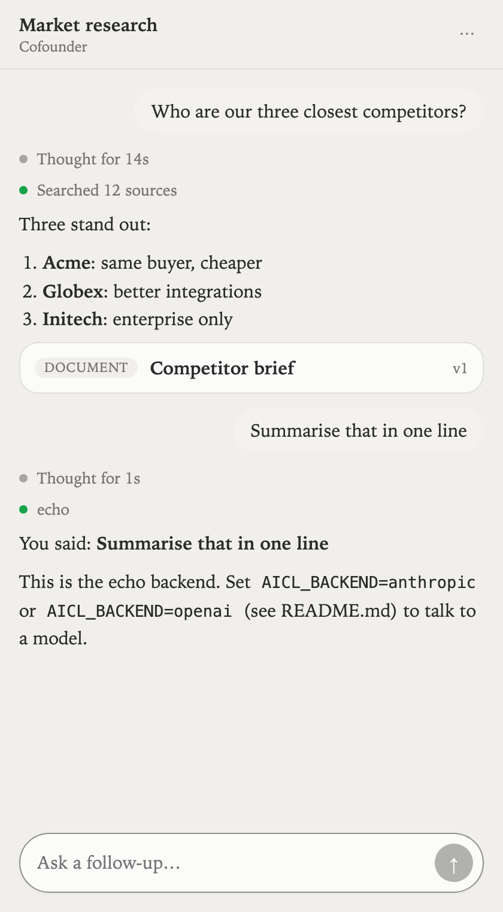
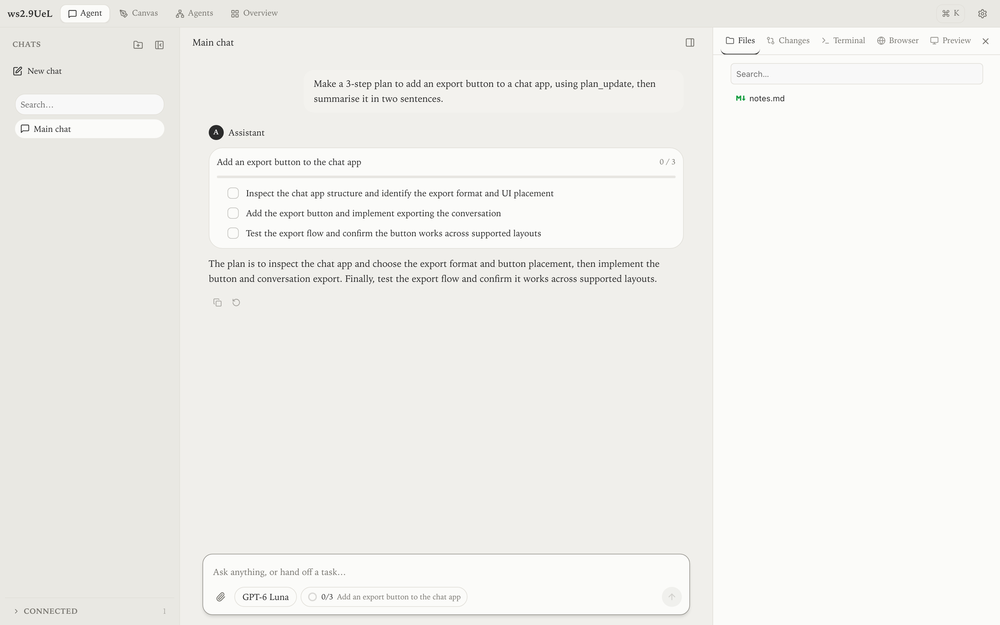

# AICL

**An open-source component library for AI chat interfaces, and a workspace where you and an agent design them together and export them as working apps.**



AICL started as a question: what do the best agentic chat products actually have in common? We labelled 1,262 screens from Devin, Manus, Lovable and Cofounder ([method](docs/CORPUS.md)), turned the evidence into [14 design decisions](docs/DECISIONS.md), and built the library from them. The repo has three parts:

| | What it is | Start here |
|---|---|---|
| **The library** | `@aicl/core` (a framework-free conversation engine), `@aicl/react` (accessible, unstyled primitives), `@aicl/server` (a streaming handler), `@aicl/styles` (an optional theme) and `@aicl/fx` (optional animated components) | [Adopting AICL](docs/ADOPTION.md) |
| **The workspace** | A local app where a person and an agent share a chat, an infinite canvas and live tools: terminals, a browser, files, diffs and processes. External agents join through a CLI and MCP | [apps/workspace](apps/workspace/AGENTS.md) |
| **Export** | Design a chat interface on the canvas by prompting for a style, then download it as a working app in React, React + Tailwind, Vue, Svelte, plain HTML or JSON | [below](#design-it-export-it-run-it) |

## Design it, export it, run it

Ask the agent for a style ("a dark, Lovable-style builder", "a Cofounder-style research side panel"), or start from a preset and edit the screen directly. Each screen is a tree of real chat elements (messages, reasoning, tool steps, plans, artifacts, composer) with a theme.

Then export it. Every runnable export keeps the design's layout and theme, starts with the designed conversation, and is live: you type, it streams.

<table>
  <tr>
    <td width="68%"></td>
    <td width="32%"></td>
  </tr>
  <tr>
    <td>Build studio → <code>html</code>, running with no build step</td>
    <td>Research panel → <code>html</code>, at side-panel width</td>
  </tr>
</table>

| Target | You get |
|---|---|
| `react` | Vite + React 19 + TypeScript |
| `react-tailwind` | the same, with Tailwind v4 utilities instead of inline styles |
| `vue` | Vite + Vue 3 single-file components |
| `svelte` | Vite + Svelte 5 |
| `html` | static HTML + a small ES module; run it with `node server/index.js` |
| `json` | the design as data: screen spec, element catalog, theme tokens, messages |

Every runnable target includes a `server/` folder with one interface to implement (`ChatBackend`) and three ready-made backends:

- `anthropic`: the Anthropic Messages API or any compatible gateway, with streamed reasoning and server-side refusal fallback.
- `openai`: any OpenAI-compatible endpoint, such as OpenAI, OpenRouter, LiteLLM, Ollama or vLLM.
- `echo`: needs no key, so you can try the UI first.

Plug in your own agent by implementing one async generator.

Export from wherever you work:

- **Canvas:** the **Export…** menu on any screen card downloads a zip.
- **In-app agent:** "export this as Vue" calls `ui_export_project` and replies with a download link.
- **Shell or another agent:** `aicl export <screen-id | spec.json> --target svelte`
- **MCP** (Claude Code, Pi, any client): `ui_export_project`, through [`bin/aicl-mcp.mjs`](apps/workspace/bin/aicl-mcp.mjs).

## The workspace



A complete agent chat product, built on the library:

- **Chats:** chats in a folder tree, a model picker, and a work panel (Files, Changes, Terminal, Browser, Preview) that fills in as the agent works.
- **Canvas:** a tldraw board you and the agent both draw on. It holds live components, UI screens, agent nodes and work frames.
- **Surfaces:** terminals, a headless browser, files, diffs and PR reviews, and background processes, all shared live. Risky actions (`bash`, writes outside `.aicl/`, commits) wait for your approval.
- **Multi-agent:** spawn sub-agents and watch them in the Agents view, with lineage and cost.
- **Open to other agents:** 56 tools over HTTP, a zero-dependency CLI and an MCP server. See the [canvas skill](apps/workspace/skill/aicl-canvas/SKILL.md).

## Quick start

```bash
git clone https://github.com/ameno-/aicl && cd aicl
npm install && npm run build          # the library (apps resolve its dist/)

cd apps/workspace && npm install
AICL_MODEL=<provider>/<model-id> npm run dev   # http://localhost:5181
```

The workspace runs its agent on [Pi](https://www.npmjs.com/package/@earendil-works/pi-coding-agent); use any model your Pi setup has credentials for. Requires Node 22.6+.

### Use the library in your own app

```tsx
import { createSseTransport } from '@aicl/core';
import { Composer, Transcript, useChat } from '@aicl/react';
import '@aicl/styles';

const transport = createSseTransport({ url: '/api/chat' });

export function Chat() {
  const chat = useChat({ transport });
  return (
    <>
      <Transcript messages={chat.messages} status={chat.status} streamingId={chat.streamingId} />
      <Composer status={chat.status} onSubmit={(text) => void chat.send(text)} onStop={chat.stop} />
    </>
  );
}
```

The server side, custom message parts, styling, testing and every known sharp edge are covered in **[docs/ADOPTION.md](docs/ADOPTION.md)**.

## Why it is built this way

- **Messages are ordered parts, not strings.** A reply interleaves reasoning, tool calls, results, prose and artifacts in one stream, and every surveyed product needs that ([D1](docs/DECISIONS.md)).
- **Three layers that change at different rates.** Conversation semantics in a dependency-free core, framework bindings in adapters, visuals in an optional theme ([architecture](docs/ARCHITECTURE.md)).
- **One wire.** A backend that yields AICL `StreamEvent`s drives any adapter, and every export ([wire contract](docs/api/README.md)).
- **Accessibility is behaviour.** IME-safe Enter, a single live region per transcript, `submitted` kept distinct from `streaming` so a send button never fires twice.

## Repository

| Path | |
|---|---|
| `packages/` | `core`, `react`, `server`, `styles`, `fx` (each has a README). `svelte` and `vue` adapters are planned |
| `apps/workspace/` | the workspace: `server/` (Node), `web/` (React), `shared/` (contracts), `templates/` (export templates) |
| `examples/` | `slice-1` (every primitive in every state), `server-node` (a minimal handler) |
| `docs/` | architecture, decisions, corpus method, domain specs, evaluations, adoption guide |

Contributing, or an AI agent working in this repo? Read **[AGENTS.md](AGENTS.md)** first.

## Status

Pre-release: packages are `0.0.0` and unpublished, so consume them from a checkout (see [Adopting AICL](docs/ADOPTION.md#1-install)). MIT licensed.
