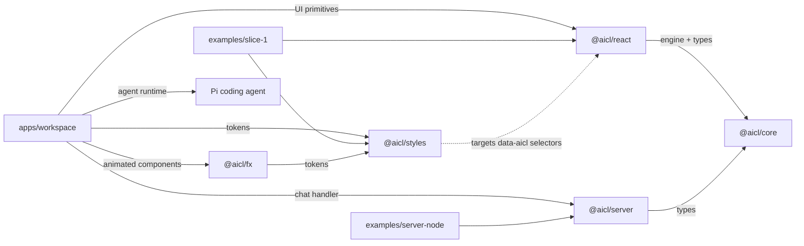

# Architecture

The repository follows the split described in `docs/ARCHITECTURE.md`. Conversation semantics live in `@aicl/core`. Framework bindings live in `@aicl/react`; `packages/svelte` and `packages/vue` are reserved but empty. Visual design is optional, in `@aicl/styles` (tokens + CSS over `[data-aicl]`) and `@aicl/fx` (animated, Tailwind-based components). The server-side wrapper is `@aicl/server`. The reference app at `apps/workspace` builds a full agentic product on all of them, and the two examples exercise subsets.

## Key files

| File | Purpose |
| --- | --- |
| `packages/core/src/types.ts` | `Message`, the `Part` union, `StreamEvent`, `ChatTransport`, `ChatState`/`ChatStatus`, `Attachment` |
| `packages/core/src/chat.ts` | `ChatController`: status transitions, stream reduction, branching, cooperative abort |
| `packages/core/src/transports/sse.ts` | The one shipped `ChatTransport` (fetch + SSE) |
| `packages/server/src/handler.ts` | `createChatHandler`, `ChatResponse.toSse()`, `ChatHandlerError` |
| `packages/react/src/Composer.tsx` | Unstyled composer: IME-safe Enter, send/stop by status, `data-*` state |
| `packages/react/src/Transcript.tsx` | `role="log"` transcript with stick-to-bottom (not virtualised; D13), `MessageItem` |
| `apps/workspace/server/main.ts` | Wires the Pi agent, session hub, canvas relay, feature modules and surfaces behind `/api/*` and `/ws/*` |
| `apps/workspace/shared/runtime.ts` | The app's contract: sessions, applets, addresses, `ServerEvent` |

## Data flow (library)

A user submits in `Composer`, which calls `useChat().send(text)`. `useChat` forwards to a `ChatController`, which rejects the call while `status` is `submitted` or `streaming`, appends the user message, and calls the `ChatTransport`. `createSseTransport` POSTs `{ messages, ...body }`. On the server, a `createChatHandler`-wrapped handler yields `StreamEvent`s, and `ChatResponse.toSse()` frames them. The controller reduces events into the assistant message's parts, and the `batched` store (`packages/core/src/store.ts`) collapses per-token writes into one notification per microtask.

## Data flow (workspace)

The workspace server keeps each conversation in a Pi session on disk and uses only the last user message from each request. Pi events are mapped to `StreamEvent`s (`server/pi-mapper.ts`). Canvas tools round-trip through the open browser tab (`server/relay.ts`), and every other live update is pushed over `GET /api/events`. Details: `apps/workspace/AGENTS.md`.

## Cross-cutting concerns

- **Framework agnosticism.** `@aicl/core` never imports a framework or touches `document`. Enforced in review (there is no CI).
- **Theming.** Primitives expose stable `data-aicl` / `data-*` attributes. `@aicl/styles` targets them, and so can any consumer CSS.
- **Branching.** The transcript is a normalised node map plus a `path` array. `edit()` forks, `selectBranch()` rewrites `path`, and `regenerate()` re-runs as a sibling.
- **Issue tracking.** Linear (`AICL-*`). Decisions that change a public contract land in `docs/DECISIONS.md`.
