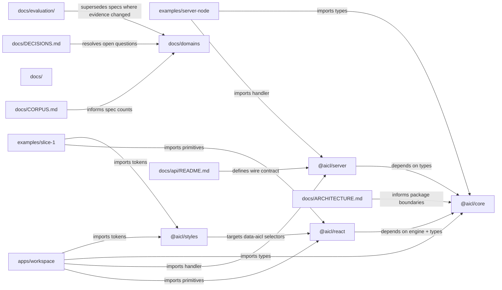

# Architecture

The repository follows the split described in `docs/ARCHITECTURE.md`: conversation semantics live in `@aicl/core`; framework bindings live in `@aicl/react` (with slots reserved for `@aicl/svelte` and `@aicl/vue`); the visual design is a separate, optional package `@aicl/styles`; and the server-side wrapper lives in `@aicl/server`. The reference app at `apps/workspace` wires all four together; the two fixtures at `examples/server-node` and `examples/slice-1` exercise subsets for docs and E2E coverage.

## Key components

| File | Purpose |
| --- | --- |
| `packages/core/src/chat.ts` | `ChatController`: status transitions (`idle`/`submitted`/`streaming`/`aborted`/`error`), stream reduction, branching, cooperative abort. |
| `packages/core/src/types.ts` | `Message`, the discriminated `Part` union, `StreamEvent`, `ChatTransport`, `ReadableStore`, `SessionMeta`, and `Attachment`. |
| `packages/core/src/transports/sse.ts` | Reference `ChatTransport` implementation that consumes Server-Sent Events from `packages/server`. |
| `packages/server/src/handler.ts` | `createChatHandler`, `ChatResponse` (SSE framing), and `ChatHandlerError` for any HTTP framework. |
| `packages/react/src/Composer.tsx` | Unstyled composer with IME-safe Enter handling, send/stop morph, and `data-*` state attributes. |
| `packages/react/src/Transcript.tsx` | Virtualised `role="log"` transcript with stick-to-bottom and a branch switcher. |
| `apps/workspace/server/main.ts` | Wires the Pi agent, the canvas relay, and the scratchpad store behind `/api/chat`, `/api/events`, `/api/scratch`. |

## Data flow

A user keystroke hits the React adapter (`packages/react/src/Composer.tsx`). On submit, the component calls `useChat().send(text, attachments)` from `packages/react/src/useChat.ts`, which forwards to a `ChatController` (`packages/core/src/chat.ts`). The controller rejects the call when `status` is in the `BUSY` set (`submitted` or `streaming`), appends the message to the transcript, and calls the registered `ChatTransport`. The default transport for fixtures is `createSseTransport` (`packages/core/src/transports/sse.ts`), which POSTs the active branch to a backend. The workspace backend is the `createChatHandler`-wrapped handler in `apps/workspace/server/main.ts`; the helper example drives `examples/server-node/src/server.ts`. The handler yields `StreamEvent` values, the controller reduces them into `Part` updates, and the batched store (`packages/core/src/store.ts`) collapses the per-token writes into one render per microtask.

## Cross-cutting concerns

- **Framework agnosticism.** `@aicl/core` and `@aicl/styles` never import a framework and never touch `document`. The rule is enforced by convention and code review at this stage (no CI workflow exists).
- **Theming.** All primitives expose stable `data-*` attributes (`data-state`, `data-role`, `data-part`, `data-aicl`). `@aicl/styles` ships the only CSS, targeting those selectors.
- **Issue tracking.** Cross-cutting work goes through Beads (`bd`). One concern per issue; decisions land as entries in `docs/DECISIONS.md` with a matching bead id.
- **Branching.** The transcript is a normalised node map plus a `path` array. `edit()` forks, `selectBranch()` rewrites `path`, `regenerate()` runs again as a sibling. The rules live in `packages/core/src/chat.ts`.
